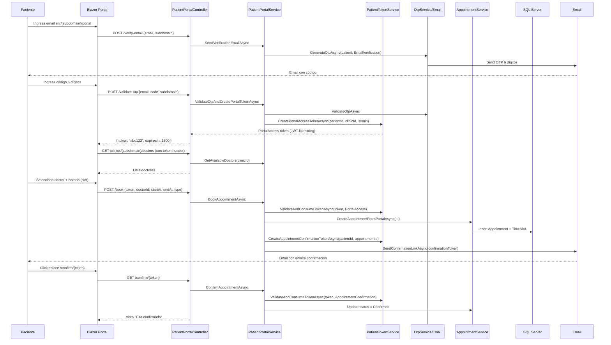

# Plan Fase 3 — Portal del Paciente

**Objetivo:** Implementar el portal público para que los pacientes reserven citas, con verificación de correo (OTP 6 dígitos), token de un solo uso, y reglas de bloqueo por impuntualidad (3 strikes).

---

## 1. Estado actual (lo que YA existe)

| Componente | Estado | Ubicación |
|------------|--------|-----------|
| Modelo `Patient` | ✅ | `SchedulingEntities.cs` |
| Modelo `PatientToken` + `PatientTokenType` | ✅ | `SchedulingEntities.cs` (PortalAccess, AppointmentConfirmation, AppointmentReminder, EmailVerification) |
| Tabla `PatientTokens` en BD | ✅ | Migración `20261123013358_AddSchedulingEntities` |
| `OtpService` + `OtpPurposes` | ✅ | `OtpService.cs` (incluye `PatientPortalAccess`, `EmailVerification`) |
| `SmtpEmailSender` (email real) | ✅ | `SmtpEmailSender.cs` |
| `ScheduleService` + `AppointmentService` | ✅ | Validación horizonte 45d, traslapes, festivos, vacaciones |
| `PatientsController` (API staff) | ✅ | CRUD pacientes (requiere auth) |

---

## 2. Qué FALTA implementar (según PRD)

### 2.1 Endpoints públicos (sin autenticación de staff)

| Endpoint | Método | Descripción |
|----------|--------|-------------|
| `/api/patient-portal/clinics/{subdomain}/doctors` | GET | Listar doctores disponibles de una clínica (para selector en portal) |
| `/api/patient-portal/clinics/{subdomain}/doctors/{doctorId}/slots` | GET | Slots disponibles en rango (respeta horizonte 45d, festivos, vacaciones) |
| `/api/patient-portal/verify-email` | POST | Enviar OTP 6 dígitos al correo del paciente (purpose: `EmailVerification`) |
| `/api/patient-portal/validate-otp` | POST | Validar OTP y crear `PatientToken` tipo `PortalAccess` (single-use, expirable) |
| `/api/patient-portal/book` | POST | Reservar cita usando `PatientToken` (PortalAccess) + datos cita |
| `/api/patient-portal/confirm/{token}` | GET | Confirmar cita vía token `AppointmentConfirmation` (enlace email) |
| `/api/patient-portal/appointments/{token}` | GET | Ver cita del paciente (solo lectura, usando token) |

### 2.2 Servicios de negocio

| Servicio | Responsabilidad |
|----------|-----------------|
| `IPatientPortalService` | Orquestar flujo completo: verificación email → token portal → reserva → confirmación |
| `PatientTokenService` | Crear/validar/invalidar `PatientToken` (tipos, expiración, uso único, revocación) |
| Extender `AppointmentService` | Método `CreateAppointmentFromPortalAsync` (paciente no autenticado en Identity) |

### 2.3 Páginas Blazor públicas (portal paciente)

| Página | Ruta | Descripción |
|--------|------|-------------|
| Landing portal | `/{subdomain}/portal` | Ingreso: email + "Reservar cita" |
| Verificación OTP | `/{subdomain}/portal/verify` | Input 6 dígitos + reenviar |
| Selección doctor/horario | `/{subdomain}/portal/book` | Calendar picker con slots disponibles |
| Confirmación reserva | `/{subdomain}/portal/confirm` | Resumen + botón "Confirmar" |
| Cita confirmada | `/{subdomain}/portal/appointment/{token}` | Vista read-only de la cita |
| Cancelación paciente | `/{subdomain}/portal/cancel/{token}` | Cancelar (aplica regla <24h → strike) |

### 2.4 Reglas de negocio específicas del portal

| Regla | Implementación |
|-------|----------------|
| Email único por clínica | Validar en `PatientPortalService` antes de crear paciente nuevo |
| Paciente nuevo vs existente | Buscar por email+clinicId; si no existe → crear `Patient` + `ApplicationUser` (sin password) |
| Horizonte reserva: 24h min, 45d máx | Ya en `ScheduleService` (`isPatientBooking=true`) |
| Bloqueo 3 strikes | Ya en `Patient.IsBlocked` + `LateCancellationCount`; validar en `CreateAppointmentFromPortalAsync` |
| Token `PortalAccess`: single-use, expirable (ej. 30 min) | `PatientTokenService.CreatePortalAccessTokenAsync` |
| Token `AppointmentConfirmation`: expirable 24h, un uso | Enviar por email tras reserva exitosa |
| No exponer datos de otros pacientes | Queries siempre filtradas por `PatientId` del token |

---

## 3. Arquitectura propuesta

```
┌─────────────────────────────────────────────────────────────────┐
│                    PATIENT PORTAL (Public)                      │
├─────────────────────────────────────────────────────────────────┤
│  Blazor Pages (Static SSR / Interactive Server)                 │
│  ────────────────────────────────────────────────────────────   │
│  /{subdomain}/portal           → PatientPortalLayout            │
│  /{subdomain}/portal/verify    → VerifyEmailPage                │
│  /{subdomain}/portal/book      → BookAppointmentPage            │
│  /{subdomain}/portal/confirm   → ConfirmBookingPage             │
│  /{subdomain}/portal/appointment/{token} → ViewAppointmentPage  │
│  /{subdomain}/portal/cancel/{token} → CancelAppointmentPage     │
└─────────────────────────────────────────────────────────────────┘
                              │
                              ▼
┌─────────────────────────────────────────────────────────────────┐
│                    API CONTROLLERS (Public)                     │
├─────────────────────────────────────────────────────────────────┤
│  PatientPortalController : ControllerBase                       │
│  [AllowAnonymous] | [Route("api/patient-portal")]               │
│  ────────────────────────────────────────────────────────────   │
│  GET  /clinics/{subdomain}/doctors                              │
│  GET  /clinics/{subdomain}/doctors/{doctorId}/slots             │
│  POST /verify-email          → Send OTP                         │
│  POST /validate-otp          → Return PortalAccess token        │
│  POST /book                  → Create appointment               │
│  GET  /confirm/{token}       → Confirm appointment              │
│  GET  /appointments/{token}  → View appointment                 │
│  POST /cancel/{token}        → Cancel appointment               │
└─────────────────────────────────────────────────────────────────┘
                              │
                              ▼
┌─────────────────────────────────────────────────────────────────┐
│                      SERVICES (Business Logic)                  │
├─────────────────────────────────────────────────────────────────┤
│  IPatientPortalService          → Orchestration                 │
│  PatientTokenService            → Token lifecycle               │
│  IAppointmentService (extend)   → CreateAppointmentFromPortal   │
│  IScheduleService               → Slot validation (existing)    │
│  IOtpService / OtpEmailSender   → OTP email (existing)          │
│  IEmailSender (SmtpEmailSender) → Confirmation emails           │
└─────────────────────────────────────────────────────────────────┘
```

---

## 4. Detalle de implementación por componente

### 4.1 `PatientTokenService` (nuevo)

```csharp
// Services/PatientTokenService.cs
public interface IPatientTokenService
{
    Task<PatientToken> CreatePortalAccessTokenAsync(Guid patientId, Guid clinicId, TimeSpan? expiry = null);
    Task<PatientToken> CreateAppointmentConfirmationTokenAsync(Guid patientId, Guid appointmentId, Guid clinicId);
    Task<PatientToken?> ValidateAndConsumeTokenAsync(string token, PatientTokenType expectedType);
    Task InvalidateTokenAsync(Guid tokenId);
    Task<bool> IsTokenValidAsync(string token, PatientTokenType expectedType);
}

// Expiraciones por defecto:
// - PortalAccess: 30 minutos, single-use
// - AppointmentConfirmation: 24 horas, single-use
// - AppointmentReminder: 24h antes de cita
// - EmailVerification: 1 hora (usa OtpService)
```

### 4.2 `IPatientPortalService` (nuevo)

```csharp
// Services/IPatientPortalService.cs
public interface IPatientPortalService
{
    Task<PortalVerificationResult> SendVerificationEmailAsync(string email, string clinicSubdomain);
    Task<PortalTokenResult> ValidateOtpAndCreatePortalTokenAsync(string email, string code, string clinicSubdomain);
    Task<PortalBookingResult> BookAppointmentAsync(string portalToken, BookAppointmentDto dto);
    Task<PortalConfirmationResult> ConfirmAppointmentAsync(string confirmationToken);
    Task<PortalAppointmentView?> GetAppointmentViewAsync(string portalToken);
    Task<PortalCancellationResult> CancelAppointmentAsync(string portalToken, string reason);
}

public record BookAppointmentDto(
    Guid DoctorId,
    DateTime StartAt,
    DateTime EndAt,
    AppointmentType Type,
    string? Notes
);
```

### 4.3 `PatientPortalController` (nuevo)

```csharp
// Controllers/PatientPortalController.cs
[ApiController]
[Route("api/patient-portal")]
[AllowAnonymous]  // ¡PÚBLICO!
public class PatientPortalController : ControllerBase
{
    private readonly IPatientPortalService _portalService;
    private readonly IScheduleService _scheduleService;

    // GET /clinics/{subdomain}/doctors
    // GET /clinics/{subdomain}/doctors/{doctorId}/slots?startDate=&endDate=
    // POST /verify-email
    // POST /validate-otp
    // POST /book
    // GET /confirm/{token}
    // GET /appointments/{token}
    // POST /cancel/{token}
}
```

### 4.4 Extensión `AppointmentService`

```csharp
// En AppointmentService.cs - NUEVO MÉTODO
public async Task<AppointmentResult> CreateAppointmentFromPortalAsync(
    Guid clinicId,
    Guid doctorId,
    Guid patientId,
    DateTime startAt,
    DateTime endAt,
    AppointmentType type,
    string? notes)
{
    // 1. Validar con ScheduleService (isPatientBooking=true)
    // 2. Crear Appointment con CreatedByUserId = patientId (o system user)
    // 3. Generar TimeSlot
    // 4. Crear PatientToken tipo AppointmentConfirmation
    // 5. Enviar email confirmación (IEmailSender)
    // 6. Retornar resultado
}
```

### 4.5 Páginas Blazor (nuevas)

Estructura de carpetas:
```
Components/
└── PatientPortal/
    ├── _Imports.razor
    ├── Layout/
    │   └── PatientPortalLayout.razor
    ├── Pages/
    │   ├── Index.razor                    // /{subdomain}/portal
    │   ├── VerifyEmail.razor              // /{subdomain}/portal/verify
    │   ├── BookAppointment.razor          // /{subdomain}/portal/book
    │   ├── ConfirmBooking.razor           // /{subdomain}/portal/confirm
    │   ├── ViewAppointment.razor          // /{subdomain}/portal/appointment/{token}
    │   └── CancelAppointment.razor        // /{subdomain}/portal/cancel/{token}
    └── Components/
        ├── DoctorSelector.razor
        ├── SlotPicker.razor
        ├── OtpInput.razor
        └── AppointmentSummary.razor
```

**Routing en `Routes.razor`:**
```razor
<Router AppAssembly="@typeof(Program).Assembly">
    <Found Context="routeData">
        <RouteView RouteData="@routeData" DefaultLayout="@typeof(MainLayout)" />
    </Found>
    <NotFound>
        <LayoutView Layout="@typeof(MainLayout)">
            <NotFound />
        </LayoutView>
    </NotFound>
</Router>

<!-- Agregar rutas del portal ANTES del fallback -->
<Router AppAssembly="@typeof(Program).Assembly" PreferExactMatches="@true">
    <Found Context="routeData">
        <!-- Portal routes with subdomain parameter -->
        <RouteView RouteData="@routeData" DefaultLayout="@typeof(PatientPortalLayout)" />
    </Found>
</Router>
```

**Subdomain handling:** Middleware o `HttpContext.Request.Host` para extraer subdominio y resolver `ClinicId`.

### 4.6 Middleware para subdominio (nuevo)

```csharp
// Middleware/ClinicSubdomainMiddleware.cs
public class ClinicSubdomainMiddleware
{
    // Extraer subdominio de Host: {subdomain}.klinara.com o localhost/{subdomain}
    // Resolver ClinicId y poner en HttpContext.Items["ClinicId"]
    // Usar en PatientPortalController y páginas Blazor
}
```

---

## 5. Flujo completo (Happy Path)



---

## 6. Configuración requerida

### `appsettings.json` (nuevas secciones)
```json
{
  "PatientPortal": {
    "PortalAccessTokenExpiryMinutes": 30,
    "AppointmentConfirmationTokenExpiryHours": 24,
    "EmailVerificationTokenExpiryHours": 1,
    "BaseUrl": "https://{subdomain}.klinara.com",
    "AllowedOrigins": ["https://*.klinara.com", "http://localhost:5000"]
  },
  "Email": {
    "SmtpHost": "smtp.sendgrid.net",
    "SmtpPort": "587",
    "SmtpUser": "apikey",
    "SmtpPass": "<from-env>",
    "FromEmail": "noreply@klinara.com",
    "FromName": "Klinara",
    "EnableSsl": "true"
  }
}
```

### Variables de entorno (producción)
- `Email__SmtpPass`
- `PatientPortal__BaseUrl`

---

## 7. Tests requeridos

| Test | Tipo | Cobertura |
|------|------|-----------|
| `PatientTokenServiceTests` | Unit | Crear/validar/consumir tokens, expiración, single-use |
| `PatientPortalServiceTests` | Unit | Flujo completo: email → OTP → token → reserva → confirmación |
| `PatientPortalControllerTests` | Integration | Endpoints públicos, validación subdominio, auth anon |
| `AppointmentServiceTests` (extend) | Unit | `CreateAppointmentFromPortalAsync` valida horizonte, bloqueo |
| Playwright E2E | E2E | Flujo completo portal: email → OTP → reserva → confirmación |

---

## 8. Orden de implementación sugerido

### Sprint 1: Backend Core (3-4 días)
1. `PatientTokenService` + tests
2. `IPatientPortalService` + `PatientPortalService` + tests
3. Extender `AppointmentService` con `CreateAppointmentFromPortalAsync`
4. `PatientPortalController` + tests
5. Middleware subdominio + registro en `Program.cs`

### Sprint 2: Frontend Portal (3-4 días)
1. `PatientPortalLayout` + estilos (usar design system)
2. Páginas: Index → VerifyEmail → BookAppointment → ConfirmBooking → ViewAppointment → CancelAppointment
3. Componentes reutilizables: `OtpInput`, `SlotPicker`, `DoctorSelector`
4. Integración API (HttpClient con base URL dinámica por subdominio)
5. Validaciones cliente + server, manejo errores, loading states

### Sprint 3: Integración y Polish (2 días)
1. Email templates reales (confirmación, recordatorio)
2. Configuración `appsettings` + user-secrets
3. Tests Playwright E2E (flujo crítico)
4. Revisión accesibilidad + mobile-first
5. Documentación en `docs/`

---

## 9. Criterios de aceptación (Definition of Done)

- [ ] Paciente puede reservar cita desde portal público sin login previo
- [ ] Verificación email con OTP 6 dígitos (expira 1h)
- [ ] Token `PortalAccess` single-use, expira 30 min
- [ ] Token `AppointmentConfirmation` enviado por email, expira 24h
- [ ] Horizonte reserva: 24h min / 45d máx (validado server-side)
- [ ] Bloqueo por 3 strikes impide reserva (validado server-side)
- [ ] No exposición de datos de otros pacientes
- [ ] Subdominio resuelve clínica correctamente
- [ ] UI mobile-first, design system aplicado
- [ ] 46+ tests unitarios existentes + nuevos tests portal pasando
- [ ] Playwright E2E: flujo completo pasando en CI
- [ ] Build 0 errores / 0 warnings

---

## 10. Riesgos y mitigaciones

| Riesgo | Probabilidad | Impacto | Mitigación |
|--------|--------------|---------|------------|
| Subdominio en localhost | Alta | Medio | Usar `localhost:5000/{subdomain}` o editar `/etc/hosts` |
| Email no entrega en dev | Media | Alto | `LoggingEmailSender` en Development, `SmtpEmailSender` en Production |
| Token replay attack | Baja | Alto | Single-use + expiración corta + HTTPS obligatorio en prod |
| Paciente existente con email en otra clínica | Media | Medio | Validar `ClinicId` + `Email` unique index ya existe |
| Zona horaria incorrecta en slots | Media | Medio | Usar `Clinic.TimeZoneId` para presentar slots al paciente |

---

## 11. Referencias

- PRD: `docs/PRD.md` (Fase 3, líneas 98-99)
- PRD Compliance: `docs/PRD_COMPLIANCE.md` (Fase 3, líneas 44-53)
- Design System: `docs/UI_DESIGN_SYSTEM.md` (Sección 6: Portal del paciente)
- Modelo datos: `Klinara.Web/Data/SchedulingEntities.cs` (`PatientToken`, `PatientTokenType`)
- Auth OTP: `Klinara.Web/Services/OtpService.cs` (`OtpPurposes.PatientPortalAccess`, `EmailVerification`)

---

*Plan generado: 2026-11-24 | Basado en código actual (build ✅, 46 tests ✅)*